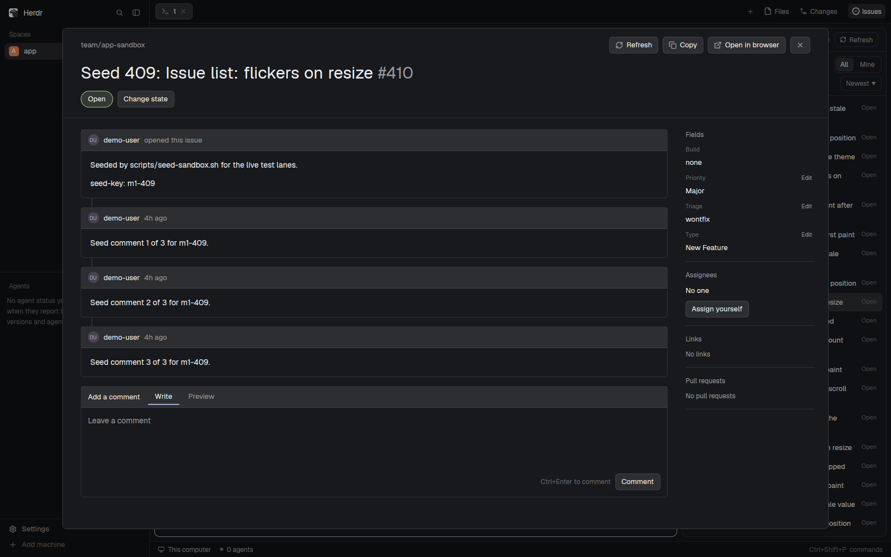

# Herdr OneDev Issues

A [Herdr](https://herdr.dev) mod that lists the OneDev issues of the repository the focused terminal is in. You can read an issue, comment on it, move it to another state, edit its fields and assign yourself without leaving Herdr.



## What it does

- Adds an **Issues** button to the tab bar, next to Files and Changes. It opens a side panel.
- The panel follows the focused terminal. It reads the folder's `origin` remote, asks `odev` which OneDev project that is, and lists that project's issues. A space remembers its project, so a folder outside OneDev keeps the last one. A space that never had a project shows an empty state, never an error.
- Issues show at once from a cache and refresh in the background. Switch between the states the project's issues use, show only your own, and sort five ways.
- A `#123` or `team/app#123` that the terminal prints shows at the top of the list, under "In this terminal".
- Click an issue to open a dialog: the description, the comments and field changes as a timeline, the fields, assignees, links and pull requests. Write a comment (Ctrl+Enter posts), change the state, edit a field, or assign yourself. Every write goes through `odev`.
- The mod never handles a OneDev token. `odev` does.

Not in this mod: avatars (it draws initials), reactions, milestones. The design and [RECIPE.md](RECIPE.md) follow the upstream GitHub mod.

## Requirements

- Herdr with mod support. `herdr-app check` must pass on the mod folder.
- [`odev`](https://github.com/johnkattenhorn/odev), a command line client for OneDev, on your `PATH` and signed in to your OneDev instance. Its README covers install and the token. The mod calls `project which`, `issue list`, `issue view`, `issue timeline`, `issue states`, `issue fields`, `issue comment`, `issue transition` and `issue edit`, so use a current build. Check it with `odev auth status` inside a clone of a OneDev project.
- Node.js 20 or later, only for the layout step and the tests.

## Install

Herdr keeps mods and layouts in `~/.config/herdr-app` (set `HERDR_APP_HOME` to use another folder).

1. Copy the mod's runtime files into the mods folder. Copy them: Herdr does not draw icons from a symlinked mod folder.

   ```sh
   mkdir -p ~/.config/herdr-app/mods/onedev-issues
   cp *.js mod.json ~/.config/herdr-app/mods/onedev-issues/
   herdr-app check ~/.config/herdr-app/mods/onedev-issues
   ```

2. Put the button and the panel in a layout. Either:

   - **Your own layout** that has a `tab-bar` row and a `panel-body` stack (a clone of Herdr's `main` that you edited, for example): run the layout step on its file. It adds the button and the panel and prints what it changed. If the layout has the upstream mod's `issues-button`, it swaps that button for this one in the same place and leaves the upstream panel in the layout. A second run prints `unchanged`.

     ```sh
     node scripts/install-layout.mjs ~/.config/herdr-app/layouts/my-main.json
     ```

   - **Herdr's `main`**: copy the ready-made clone and switch to it. It is `main` 0.1.12 with the button and panel added.

     ```sh
     cp layouts/main-onedev-issues.json ~/.config/herdr-app/layouts/
     herdr-app do layout.switch '{"name":"main-onedev-issues"}'
     ```

3. Open a terminal in a clone of a OneDev project and press **Issues**.

Saving a mod file reloads it. A dialog that was open at that moment shows "interrupted": close it and open it again.

## Configuration

The mod looks for `odev` on your `PATH`. To use another binary, write its absolute path to `config.json` in the mod's data folder, `~/.config/herdr-app/data/onedev-issues/config.json`:

```json
{ "odev": "/home/you/.local/bin/odev" }
```

The value must be a bare command name or an absolute path. Any other value is refused, and the panel says why.

## Develop

```sh
node --test            # unit tests, no network and no OneDev
node --check main.js   # syntax check of a file
```

`scripts/seed-sandbox.sh` fills a throwaway OneDev project with 420 issues for live tests. It writes nothing without `--apply`, and only to a project whose path ends in `-sandbox`. Pass the target with `SEED_PROJECT`, `SEED_HOST` and `SEED_ASSIGNEE`.

CI runs `node --test` on every push and pull request (`.onedev-buildspec.yml`).

## Credits

The design follows [herdr-issues](https://github.com/jankeesvw/herdr-issues) by Jankees van Woezik (MIT), which does the same for GitHub issues through `gh`. This mod is built fresh from that mod's recipe, for OneDev's states, custom fields and query language. [RECIPE.md](RECIPE.md) keeps the upstream sections, adapted.

## Licence

MIT. See [LICENSE](LICENSE).
