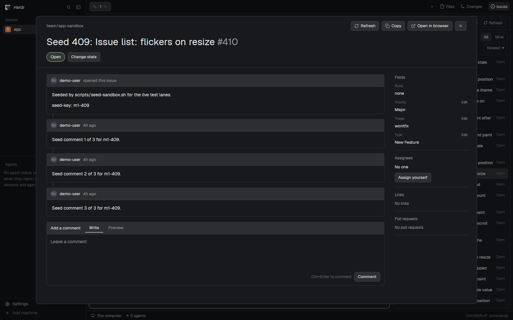

# Herdr OneDev Issues

A side panel beside Files and Changes that lists the OneDev issues of the project the focused terminal is in, with the issue numbers that terminal mentions at the top, and a dialog to read an issue, comment, change its state, edit its fields and assign yourself.

This recipe is adapted from the `RECIPE.md` of [herdr-issues](https://github.com/jankeesvw/herdr-issues) by Jankees van Woezik (MIT), which does the same for GitHub through `gh`. It keeps that recipe's sections and rewrites each for OneDev and `odev`. Where OneDev has no equivalent, the section says what was left out.

## What you see

- **The Issues button**, at the right end of the tab bar after Files and Changes: a 26px pill with a circle-dot icon and "Issues", `selected` while its panel shows, `chrome` otherwise. It sits in a 42px `tab-bar` row and shows a spinner while it checks a folder.
- **The panel**, in the side panel column as a card.
  - A 42px header: a green (`ansi2`) circle-dot icon, "Issues" semibold, the project path (`group/name`, 11px, `dim`, truncated, right-aligned) and a bordered "Refresh" button, or a spinner and "Syncing".
  - A control area: a segmented control with one segment per **state** the project's issues use, each with its count ("Open 177 | Closed 100"); a segmented "All | Mine"; and a sort button ("Newest ▼") that opens a row of sort choices: Newest, Oldest, Recently updated, Least recently updated, Most commented.
  - The list: rows of `#number` (40px wide, `dim`), the title (wrapping, two lines at most) and the issue's state on the right. When the focused terminal mentions issues, an "In this terminal" heading comes first with those rows, then a heading for the list below.
  - Before any project has been seen: "No project yet" and "Focus a terminal inside a OneDev repository and its issues show up here."
- **The issue dialog**, a large overlay:
  - A top bar: the project path, a Back button after following a link, an error if the last action failed, a spinner while loading, and Refresh, Copy and Open in browser buttons and a close button.
  - The title with a `muted` `#number`, then a state pill and a "Change state" button.
  - Left, the **timeline**: one card per comment (header with an initials circle, the login, "opened this issue" or the age), and between the cards one line per change (state changes, field changes, link changes) with the old value struck through. Then "Add a comment": a card with Write and Preview tabs, a growing textarea and a "Comment" button.
  - Right, a sidebar of sections: **Fields** (each custom field of the issue with an Edit link where the field has a fixed list of choices), **Assignees** ("No one" and "Assign yourself", or "Unassign"), **Links** (linked issues) and **Pull requests**.
- **The copy menu**, a popup from Copy in the dialog or a right-click on a row: Copy link, Copy reference (`group/name#27`), Copy number (`#27`) and Copy number and title.

Left out on purpose: avatars (initials in a coloured circle instead), reactions, author roles, label chips (OneDev has custom fields, not labels) and milestones.

## How it behaves

- The panel follows the focused terminal's folder (`panes()[i].cwd`). `odev -C <folder> project which --json` says whether it is a OneDev clone, from its `origin` remote, and which project. The answer is kept per folder. Each space remembers the project its terminals were last in, across restarts: a folder outside OneDev keeps it, and a space that never had one shows the empty state, never another space's project or an error.
- A project's issues show at once from the cache (`data/onedev-issues/project-<host>__<project>.json`; a cache that cannot be read, or is over 8 MiB, is refetched). The first time, and whenever the cache is missing or from an older version, the panel fetches the issues in full (`odev issue list --json --state all -L 500`). Every 30 seconds while the panel shows, it fetches only issues changed since the last sync (`--since`, with an overlap) and merges them by number. Refresh syncs now.
- While the panel is not the shown side panel, it does not sync or read terminals. Showing it syncs at once.
- Every 3 seconds it reads the focused terminal (`hc read --lines 300`) for `#123`, `group/name#123` and links to the project's issues, in either spelling of the host (the address in the clone's remote, and any alias that `odev config` knows). Newest line first, up to 8. A number that is not in the cache is looked up once (`odev issue view`) and remembered, including numbers that do not exist.
- The state segments are the instance's states in their order. A project whose token cannot read the settings still works: the order and the fields come from the issues themselves.
- Mine keeps issues assigned to you (`odev issue list --assignee me`; your login comes from `odev auth status`).
- Clicking a row opens the dialog with the cached issue, which shows at once and refreshes behind it.
- In the dialog, `#123`, `group/name#123` and links to the project's issues or pull requests outside code open in the dialog (pull requests open in the browser); other links open in the browser through `xdg-open`.
- Opening an issue loads it in full (`odev issue view`), its timeline (`odev issue timeline`), the instance's states and fields and your login. Comments, field changes, state changes and link changes become one list in date order.
- Comment posts the box (Ctrl+Enter also posts; Enter and Shift+Enter type a newline). One draft is kept per issue, so following a link and coming back does not lose it. Change state moves the issue to the chosen state and takes the box's text along as its comment. A field's Edit lists the field's choices. Assign yourself and Unassign edit the Assignees field. Every write runs one `odev` command, reloads the issue and tells the panel through shared state, which refetches it so the list is current.
- A failed write leaves the box as it was and shows the `odev` error in the top bar.
- The mod never reads a token. It runs `odev`, from `PATH` or from the `odev` key of `data/onedev-issues/config.json`, and reads only its output.

## Built from

- **Layout** (`layouts/main-onedev-issues.json`): Herdr's `main` 0.1.12. The `tabs` block sits in a 42px row `tab-bar` with a 78px block `onedev-issues-button` (`{ mod: "onedev-issues", props: { button: true } }`, `window_drag`). The `panel-body` stack gets a child `onedev-issues` (`{ mod: "onedev-issues" }`). The ids differ from the upstream mod's (`issues-button`, `issues`), so both mods can sit in one layout. `scripts/install-layout.mjs` makes the same change to a layout you already have. By default it adds the button and the panel child and leaves the upstream blocks alone, so each mod keeps its own button. With `--replace-github-button` it puts this mod's button in the upstream `issues-button` slot, wherever that block sits under `tab-bar`, and keeps a copy of the block at `content.props.replaced` on the button (the upstream panel child stays, and the panel switches to it for a folder outside OneDev or a failed lookup). `--remove` undoes either form: it puts `replaced` back verbatim, or deletes the button when there is no marker. `scripts/build-layout.mjs` builds the shipped file from Herdr's `main.json`.
- **Mod** `mods/onedev-issues/`: `main.js` is the panel, the button (props `button`) and the dialog host (overlay props `issue: { … }`); `viewer.js` draws the dialog; `model.js` and `issue-model.js` hold the pure logic; `cache.js` holds the cache, the sort orders and the mention scanner; `odev.js` is the only module that runs `odev`; `writes.js` turns a dialog action into an `odev` command; `markdown.js` rewrites issue references into links; `icons.js` writes the Lucide icons to the data folder.
- **herdr**: `spaces`, `panes`, `focused`, `layout`, `theme`, `exec`, `hc`, `run` (`layout.select`, `layout.show`), `openOverlay`, `closeOverlay`, `props`, `shared` and `setShared` (`onedev-issues.changed`, `workspace.panels`), `appHome`, `localStorage` (verdicts per folder, the project per space, view preferences), `fs/promises` (the cache).
- **gpui-base**: `TextView.markdown` with `on_link_click`, `TextareaState` and `Textarea`.
- **Programs**: `odev` (`project which`, `auth status`, `config view`, `issue list`, `issue view`, `issue timeline`, `issue states`, `issue fields`, `issue comment`, `issue transition`, `issue edit`) and `xdg-open`.

## Watch out

- Herdr does not draw SVGs or images from a symlinked mod folder (JavaScript loads fine), so the icons live in the data folder and are drawn only once they are on disk. Copy the mod, do not symlink it.
- Herdr does not dock a symlinked mod from `mod.json`; `place` is `none` and the layout places it.
- The markdown view (`TextView.markdown`) draws no images, not even the alt text.
- `init`'s first argument is not the overlay's props: read them with `props()`.
- The marker decides shared mode. The button holds the GitHub slot only when `content.props.replaced` is an object with `id: "issues-button"`, and `readPanel` and `--remove` share that one test (`holdsGithubSlot`). Never infer it from the layout's shape: a GitHub button in a sub-row, or a GitHub panel with no button, looks the same. A malformed marker counts as no marker.
- Saving a mod file reloads it. A dialog that was loading at that moment shows "interrupted". Reopen it.
- `odev` reports a host by one spelling. A clone over SSH, or by IP address, has a different host from one over a DNS name unless `odev config set alias.<spelling> <url>` joins them. The mod asks `odev` for the spellings and accepts all of them in links and in the terminal text.
- A non-admin token cannot read OneDev's issue settings, so state colours and unused field values are not available. The mod shows what the issues use.
- OneDev accepts an unknown login in Assignees without an error. Assign yourself uses the login `odev auth status` reports.
- The comment count in the list comes from the cache and is only as fresh as the last sync.

## Done when

- `herdr-app check ~/.config/herdr-app/mods/onedev-issues` passes.
- The tab bar shows Files, Changes and Issues. Issues opens and closes the panel, and switching spaces restores it.
- In a terminal inside a OneDev clone, the panel lists the project's issues. Each state segment, All, Mine and each sort order change the list.
- `echo "#12"` in that terminal puts #12 under "In this terminal" within 3 seconds.
- A row opens the dialog at once. A `#number` link in the body opens that issue, and Back returns.
- A comment, a state change, a field edit and Assign yourself show in OneDev and in the panel's list.
- In a folder that is not a OneDev clone, the panel shows its empty state and no error.
- `node --test` passes.
